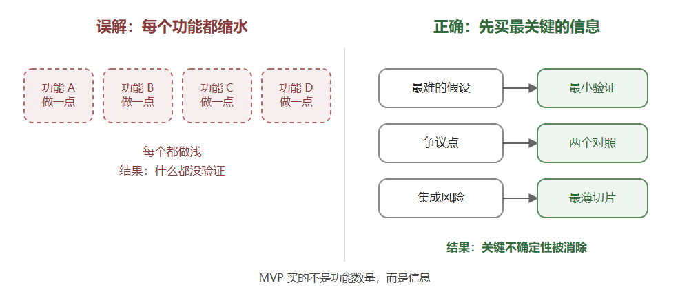
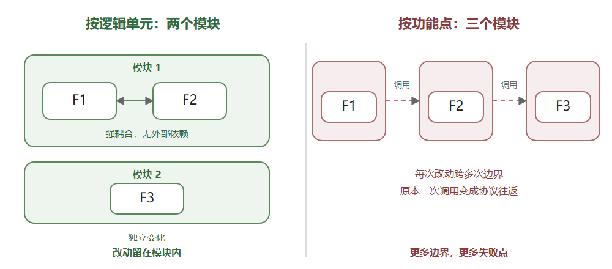
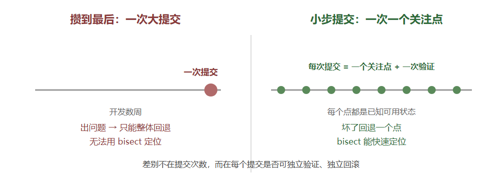
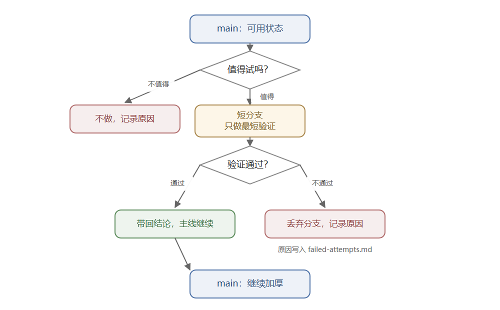

# Development as a Verifiable System

## My Engineering Method: Four Loops and Six Costs

> Version: 2026-10 · Genre: engineering method + cross-project retrospective
> For: independent developers, technical leads, engineers who work with AI over long periods

---

## One-Sentence Conclusion

**Efficiency is not writing more code per hour; it is lowering six costs: decision, rework, context, risk, coordination, and maintenance.**
The core of the method is one sentence: **make things provable first, then make them fast.**

---

## Quick Guide

### If You Only Have Three Minutes

Most development time is not spent "writing code." It is spent on:

- re-understanding the version of yourself from last week;
- stepping into a pit you already stepped into;
- repeatedly discussing "what exactly are we building?";
- not knowing whether a change broke something;
- adding more and more until nothing can be deleted;
- being unable to pick up the work when the person (or the AI session) changes.

What I do is not "write harder." It is to build one loop for each of those six problems:

1. **Intent loop:** write goals, non-goals, and hard constraints before writing code.
2. **Evidence loop:** instrument first, conclusions second; every conclusion points to a report.
3. **Convergence loop:** expand first, delete later; deletion has criteria, refactoring has machine proof.
4. **Memory loop:** let docs, tasks, changes, and failure records remember for me; next time I do not have to re-think.

There is also a master switch: **do not overthink.** Once the smallest end-to-end loop is settled, build it; let evidence answer the rest, not imagination. Do not spend energy on "might exist someday" requirements, and do not fight imaginary enemies.

In one sentence: **treat development as a verifiable system, not a continuous performance held together by memory.**

### If You Are Solving a Specific Problem

| Problem you are facing | Section |
|---|---|
| Requirements keep changing; the work drifts | 3.1 |
| You do not know whether a change broke something | 3.2, 3.3 |
| The same pit was stepped into twice | 3.2, 3.4 |
| The project grows and cannot be deleted | 3.3 |
| A new person or AI session cannot pick it up | 3.4 |
| Whether to split a module/service | 3.3 |
| What an MVP should actually do | 3.1, 3.2 |
| How often to commit, how to use branches | 5.3 |
| Busy all day but unable to say what was produced | 4, 5 |
| Whether this method holds across many projects | 6 |
| Want to copy the templates directly | Appendix A |

### If You Remember Only Three Sentences

1. **A "done" that cannot be verified is an illusion.**
2. **Context that cannot be handed over is a liability.**
3. **A system that cannot delete will rot.**

---

## Abstract

This article summarizes a development method used repeatedly across more than ten projects in different languages. It is not a toolchain checklist; it is four loops: intent, evidence, convergence, and memory. The intent loop uses goals, non-goals, and hard constraints to rule out wrong directions before code is written. The evidence loop requires every conclusion to point to a reviewable report and records failures and negative results. The convergence loop turns "expand first, delete later" into engineering actions with criteria. The memory loop makes design, tasks, changes, and worklogs a handoverable context.

Running through the four loops are five working principles: smallest loop first, do not design for imaginary enemies, leave seams before growing flesh, cut modules by logical unit, and let the MVP validate the hardest point. At the execution level, two things control risk: small commits cut changes into rollbackable slices, and short branches let uncertain new directions be tested or discarded at the lowest cost. The article uses six costs to explain why the method is efficient, and gives a daily/weekly operating rhythm, cross-project evidence, anti-patterns, and costs. All cases come from real projects; client names and project identifiers have been removed.

**Keywords:** engineering method; evidence first; verifiability; convergence; AI collaboration

---

## 1. The Problem: Why "Effort" Is Not "Efficiency"

A counterintuitive fact: writing code is usually not the most time-consuming part.

What actually consumes time:

- **Decision:** should this be done at all, to what degree, and what counts as done?
- **Rework:** the direction was wrong, or it was finished and then found unverifiable;
- **Context rebuild:** coming back three days later and forgetting why it was written this way;
- **Risk:** the change is too large to touch; after touching it, you do not know whether it broke;
- **Coordination:** the person, the AI, and your future self understand the same code differently;
- **Maintenance:** features only go in, never out, and the system grows every year.

These problems share one property: **none of them can be solved by "writing faster."**

Solo development + AI collaboration amplifies them. AI is fast, but it forgets, it is confidently wrong, and it continues down your assumptions. The bottleneck moves from "typing speed" to two things:

1. **Can you state clearly what you want?**
2. **Can you judge whether it was done correctly?**

This method grew around those two questions.

---

## 2. The Core Proposition

> **Development is not translating an idea into code; it is turning intent into a system that is verifiable, handoverable, and convergeable.**

Three corollaries:

- **A completion that cannot be verified is an illusion.** "It should work" is not a state of done.
- **Context that cannot be handed over is a liability.** Information that exists only in your head is equivalent to no information.
- **A system that cannot delete will rot.** Add without subtract, and complexity compounds.

### Five Working Principles

| Principle | Meaning | Anti-pattern |
|---|---|---|
| **Smallest loop first** | Think only until an end-to-end loop can run, then build it | Think for three months without building |
| **Do not design for imaginary enemies** | No second user, no abstraction | Pre-write a plugin layer for a future platform |
| **Leave seams before growing flesh** | Design entry/exit points; do not implement early | Hard-code the trunk, or build the wheel early |
| **Cut modules by logical unit** | Keep things that live and die together; separate things that change independently | One module/microservice per feature point |
| **MVP validates the hardest point** | Buy information, not features | Shrink every feature a little |

The four loops below correspond to the three corollaries; the five principles run through all of them.

---

## 3. The Four Loops

### 3.1 Intent Loop: Write Constraints Before Code

The first document of every project is not a README; it is `design.md`. It answers only four questions:

1. What is this?
2. What are the goals?
3. **What are the non-goals?**
4. **What are the hard constraints?**

The last two matter most.

**Non-goals are first-class citizens.** They are not "later"; they are "explicitly not doing this now, with a written reason." For example:

- An offline speech project wrote: "Real-time dictation has been removed from scope. Do not reintroduce it without a new design review."
- A document-ingestion project wrote: "Embeddings and rerankers, ever. Not 'later,' not 'optional.'"
- An anti-cheat model project wrote: "This is a research model, not an automatic ban system."

The purpose of a non-goal is not to limit ambition; it is to **hit the brake at the moment you are most tempted to "just add one thing."**

**Hard constraints come before technology choices.** Constraints are numbered (C1, C2, ...), and each carries a consequence:

| Constraint | Consequence |
|---|---|
| No GPU; CPU from 2013 onward | Rules out a class of models |
| No outbound network at runtime | Rules out cloud ASR and online updates |
| No `unsafe` | Rules out some dependencies and signal-handling patterns |
| Zero configuration | The default path cannot require a user decision |

Once constraints are written down, 80% of bad designs are ruled out before they cost anything.

**Amend with a trace; do not rewrite history.** Constraints change, but changes carry a date and a reason. In one project, "zero configuration" was later amended to "zero configuration by default, but advanced users can see and change the engine" — the original sentence was kept and the amendment appended, because the judgment it protected still held.

**Record rejected options.** `design.md` has a section for "options considered and not adopted." That half is often more useful than the final design: it tells the next person which roads were already walked and why they did not work.

In a real ADR, the decision to move the merchant client to a mini-program also recorded two rejected options: keep the web client and add a mini-program (the same rule implemented twice; the repository had already produced real defects from that), and merge into the same AppID (the review entity and permission boundary would be tied together). Recording rejected options is not a ritual; it saves the next person from re-arguing.

#### Smallest Loop: Build First, Think Clearly Later

"Do not overthink" is not "do not think." It is **to put the boundary of thinking at "the smallest end-to-end loop that can run."**

- **Think about:** the core value, the shortest verifiable path, and what "it runs" means;
- **Do not think about:** expansion in three years, ten possible platforms, five possible user types.

Once the smallest loop is settled, build it. What you build will tell you which part you thought wrong; what you never build only makes you keep thinking.

The examples are consistent across projects: a runtime project connected "kernel → agent loop → server → deployment" end to end on the second day, instead of perfecting each layer first; an offline speech project verified that the engine could run on the target CPU before building the UI; a document-pipeline project built the evaluation harness before choosing a model. The common point: **make the shortest path work first, then decide which segment deserves to be thickened.**

#### Do Not Design for Imaginary Enemies

One class of work is pure consumption: abstracting early for "might exist someday" requirements.

- There might be a second database? Write a storage abstraction first.
- We might switch message queues? Wrap pub/sub first.
- There might be ten callers? Design a plugin protocol first.

The problem is not that these abstractions are necessarily wrong; it is that **you are using a real project's budget to fight an enemy that does not exist.** If that future actually arrives, your abstraction is probably wrong anyway — because you had no real constraints.

The criterion is simple: **does this abstraction have a second user today?** If not, do not abstract. Wait for the second user, then refactor; by then you have real information, and the cost of refactoring is far lower than the cost of designing ahead.

#### Leave Seams, Not Implementations

"Do not overthink" is not "hard-code." The difference:

- **Leave a seam:** think through where future additions/deletions enter and exit;
- **Implement early:** write that thing now.

A seam is cheap: an entry, a registration point, a boundary, a config item. An implementation is expensive: code, tests, docs, maintenance.

The criterion: **if that future change actually happens, can the change be confined to one known location?** If yes, a seam is enough; if not, you need a heavier abstraction. Leave the seam first; grow the flesh later.

### 3.2 Evidence Loop: Instrument First, Conclusions Second

This is the strongest rule in the method, and the hardest to keep.

**A task starts from a symptom, not a feature.** The first paragraph of a task doc is not "I will implement X"; it is "what was observed":

- the user's exact words;
- a log excerpt;
- a state table: at what time, in what app state, which log line appeared, which one did not;
- what has already been ruled out.

Then come the hypothesis, root cause, fix, and verification.

**Every step needs a verify.** The task is split into numbered steps, and every step carries one line: "how do we prove it is done?" Not "implement X," but "run this command and see this result."

**Every conclusion must point to a report.** One project has an `evidence.md` with this rule:

> A number may appear in a design or task doc only if a row below names the report that backs it. A number without a row is "to be re-run," not "citable."

Another document puts it more directly:

> A number that cannot be wrong is not a measurement.

**Failures must be recorded; negative results are results.** One project maintains `failed-attempts.md`, specifically for "roads tried and abandoned," with numbers, dates, and reasons. Another project's rules say:

> Report negative results. "The sweep found nothing" and "this switch is not worth its cost" are both findings.

**Validate the instrument before trusting the reading.** This is the most easily overlooked rule. Real cases:

- A probability probe returned 0.001 for every file, which looked like a code-path bug; the real cause was a missing context window — **the instrument was broken.**
- A "zero hits" result turned out to be a fourteen-hour-old binary — **measuring something new with an old ruler.**
- A plausible mechanism explanation failed the test three times in a row — **a plausible mechanism is not a diagnosis.**

So one rule: **when you have a hypothesis, write the test that would falsify it first.**

A concrete example: during the GAIA round, a 30-question subset was used for regression — fixed model, temperature, and version; change the hierarchy and context order; record failure modes. Scores were not used as conclusions; failure modes went into the design (the per-question raw data was later lost; the failure taxonomy survived).

**A gate must be proven to fail.** One corporate-website project has nine automated gates (layout, readability, animation, authentication, lock, dialog, flow, ...). Before a new gate goes live, the corresponding problem must be deliberately created and the gate confirmed to fail; only then is it trusted.

> Every new gate must be "deliberately broken" once, proving it will fail, before it is trusted.

**Experiments need pre-registered rules.** One model project uses a champion/challenger protocol:

- fixed folds, the same set for every variant;
- the primary metric is fixed (for example, player-level recall at FPR = 1%);
- a challenger replaces the champion only if the primary metric improves and the secondary metrics do not materially degrade;
- if metrics tie, keep the simpler model;
- every experiment writes a report and is registered in the experiment table, including negative results.

The value of these rules is not "more scientific"; it is **preventing post-hoc explanation**: people easily invent a reason for a result already in hand, and pre-registration makes that hard.

#### MVP: Buy the Most Critical Information at the Lowest Cost

MVP is often misunderstood as "make a smaller version of every feature." That is not an MVP; that is **making everything shallow once** — every feature is unverified, every risk remains.

My definition of MVP is: **at the lowest cost, validate the hardest, most controversial, or most uncertain points in the product.**

- Technical feasibility uncertain → build a spike first, prove it runs;
- Whether users will use it uncertain → build a loop that covers only the core action;
- Integration risk highest → connect the hardest segment first;
- The approach is controversial → build two minimal comparisons and decide with data.



*Figure 1: Two readings of MVP*

The output of an MVP is not "a version with few features"; it is **a set of eliminated uncertainties.** Few features is a side effect, not the purpose.

This is the two sides of "smallest loop": the smallest loop answers "can the path run?", the MVP answers "is the assumption most likely to overturn the plan actually true?" Neither pursues completeness; both pursue **real information as fast as possible**.

### 3.3 Convergence Loop: Expand First, Delete Later

Most systems do not die from too few features; they die from features that only go in.

**Expand first, converge later.** Early on, allow roughness and duplication, and lay out the capability surface; but there must be an explicit convergence period that does three things:

1. **Delete capability surfaces:** remove features nobody uses or that the system should not own;
2. **Delete duplicate surfaces:** two protocols, two implementations, two entries converge into one;
3. **Delete structural debt:** split giant files, converge state fields, fix layer inversions.

**Deletion needs a criterion.** "The frontend never calls it" is not sufficient, because:

- operations may still call it;
- an AI/agent may still call it;
- it might be needed later.

So my criterion is: **does it constitute the system's capability surface?** If yes, keep it; if not, delete it. Before deleting, make three maps: crate level, route level, feature level, and decide item by item.

#### Cut Modules by Logical Unit, Not by Feature Point

Module boundaries should not be distributed evenly by "number of feature points," nor should they be hard-split into microservices or independent modules just to "look architecturally clean." Boundaries should follow **logical units**:

- two functions that are deeply intertwined and have no independent external dependency → one module;
- a function with an independent lifecycle, callers, and failure domain → its own module;
- a business with three functions, where two are strongly coupled and the third is independent → **two modules, not three.**



*Figure 2: Cutting modules by logical unit*

The cost of hard splitting is not "a few more files"; it is:

- every change requires cross-module coordination;
- what was one function call becomes a cross-boundary protocol;
- error handling, transaction boundaries, and data consistency are forced outward;
- you pay real complexity for "clarity."

The criterion for a module is not "it does one thing," but "do its concerns share the same reason to change." **Keep things that live and die together; separate things that change independently.**

**Refactoring needs machine proof.** A large refactor easily becomes "I think I did not break it." My practice:

- every commit passes the full test suite independently; any step can be rolled back alone;
- pure moves are audited segment by segment with `--color-moved`, proving "this is only a move";
- cross-language contracts use golden fixtures asserted on both sides;
- the old frontend is frozen as a golden master; the new frontend catches up in batches before switching;
- control-flow changes use sentinel enums, not an extra `if` wrapper.

**Corrections do not erase history.** The change log is append-only: the original entry stays, and a correction is a new entry. Superseded documents are not deleted; they are marked "superseded, kept for the reason." This is not fussiness; it lets the next person see "why we thought that at the time."

**Releases must be rollbackable.** Versions, checksums, release notes, and install/uninstall paths are required; the previous build is kept as a rollback baseline.

### 3.4 Memory Loop: Make the Method Independent of Memory

The first three loops solve "do it right"; this one solves "do it right again next time."

**A unified documentation skeleton.** Whether the project is Rust, Go, Python, or TypeScript, it has the same structure:

```
docs/llmwiki/
  design.md      current state, goals, non-goals, hard constraints, rejected options
  tasks/         one per unit of work, numbered steps + a verify per step
  changelog.md   append-only change log, explaining "why"
```

The skeleton holds across languages, which shows it is not an accessory of a framework but the method itself.

**Rebuild the worklog from evidence.** At the end of a project, rebuild `WORKLOG.md` from git records, file timestamps, and runtime logs. The rule:

> Do not fill in or infer working days without evidence.

The log explicitly records "evidence and gaps": which days had no commits, which conclusions cannot be reviewed. **Admitting a gap is more useful than inventing a complete story.**

**Freeze state in a handover document.** One project maintains `next-session.md`: current frozen state, next step, stop rules, timebox. The purpose is not planning, but letting the next session (human or AI) start without starting from zero.

**Make the project agent-readable.** This is not "writing docs for AI"; it is designing interfaces an agent can use directly:

- every command has `--json`, results on stdout, diagnostics on stderr, distinct exit codes on failure;
- the project root has `llms.txt`, listing commands, parameters, and constraints in a machine-readable way;
- the CLI owns the full capability; the GUI is a minimal shell;
- `AGENTS.md` is written as a contract: what to read first, how to commit, what not to do, how to verify.

The opening of one offline-speech project's `AGENTS.md`:

> These are not style preferences — each one exists because something went wrong without it.

That sentence can serve as the footnote of the whole method: **a rule is not aesthetics; it is sedimented incident.**

---

## 4. Six Costs: The Ledger of Efficient Development

Translated into "why is it fast?", the method is a reduction of six costs:

| Cost | Practice | Benefit |
|---|---|---|
| **Decision cost** | Write goals, non-goals, and hard constraints first | Stop re-arguing "should we do it" |
| **Rework cost** | Instrument first, falsify first, define acceptance first | Do not build what cannot be verified |
| **Context cost** | design / tasks / changelog / worklog | No need to rebuild memory next time |
| **Risk cost** | Small commits, short-branch validation, golden master, rollback | Dare to refactor, dare to try new directions |
| **Coordination cost** | AGENTS.md, llms.txt, `--json` | Both humans and agents can take over |
| **Maintenance cost** | Single entry, deletion criteria, convergence period | The system does not grow with every feature |

Notice that "typing speed" is not on the list. **Efficiency is reducing wasted actions, not increasing the density of effective actions.**

---

## 5. How a Day and a Week Run

### 5.1 A Day

**Start (10 minutes)**

- Read the current state in `design.md`;
- Read the unfinished task in `tasks/`;
- Read the frozen state in `next-session.md`;
- Pick **one thing**: either advance the smallest loop or validate the hardest point; write down its acceptance criteria.

**During the day**

- Advance one task document at a time;
- Write the verify line before the implementation;
- When a step is done, check it and run the verification;
- Commit in small, independent, rollbackable steps;
- When you meet a hypothesis, write the falsification test before the implementation.

**End (10 minutes)**

- Update the task document: what was done, where it is stuck, what is next;
- Update `changelog.md`: why it changed, not what changed;
- If there was a failure or a negative result, write it into `failed-attempts.md`;
- If the design changed, update `design.md` with a date.

### 5.2 A Week

- **Evidence audit:** find every number without a report; either add the report or delete the number;
- **Convergence:** delete one thing that no longer constitutes the capability surface;
- **Structure check:** are any files/functions/state fields beyond a readable threshold?
- **Release:** if there is a batch of verified changes, cut a version and keep a rollback baseline;
- **Retrospective:** what was the biggest rework this week? Which loop could have caught it?

### 5.3 Commits and Branches: Small Steps, Fast Elimination

#### Why Many Commits Instead of One Big One at the End

It is not "the more commits the better"; it is: **one commit = one concern + one verification + one reason.**

Saving everything for one big commit is not a problem of "big"; it is that:

- when it breaks, you can only roll back the whole thing and cannot localize;
- there is no usable state in between, so `git bisect` has nowhere to start;
- review faces one enormous diff;
- handover cannot explain which step introduced what;
- you cannot release one of the fixes separately.

Small commits buy five capabilities:

| Capability | How it comes |
|---|---|
| **Rollback** | Every commit is a known-good state |
| **Localization** | `git bisect` finds the problem in logarithmic steps |
| **Review** | One diff answers one question |
| **Handover** | The commit message is a decision record |
| **Cherry-pick** | A fix can be released alone |



*Figure 3: One big commit vs. small verified commits*

But note: **commit granularity is semantic, not temporal.** `git commit -m "wip"` every five minutes is not small-step committing; it is noise. A good commit can explain "why" on its own.

Exception: a genuinely mechanical large change (repository-wide rename, formatting) can be one big commit, but the message must state "this is a pure mechanical change" and prove with `--color-moved` or an equivalent that no behavior change is smuggled in.

#### Branches: Validate a New Line at the Lowest Cost

When a new direction is uncertain, do not think and edit on the main line. Open a short branch and do only the shortest validation:

- before starting, write down what result counts as "pass" and what counts as "abandon";
- do only the part that answers the question, not the full feature;
- keep the main branch usable at all times;
- pass: bring the conclusion back to the main line and continue;
- fail: discard the branch and write the reason into `failed-attempts.md`.



*Figure 4: Branch validation flow*

Two easy ways to drift:

1. **The branch becomes a second product.** A branch exists to buy information, not for long-term parallel development; when the timebox expires, merge or discard.
2. **Merge the spike as-is after it passes.** Validated code often carries spike roughness; the better move is to bring the conclusion back to the main line and rewrite it cleanly.

In one sentence: **code you can afford to throw away is cheap code.**

---

## 6. Cross-Project Evidence

This method does not hold in only one project. Over the past months, I have reused the same skeleton across different languages and domains:

| Practice | Where it appears | What it buys |
|---|---|---|
| `design.md` + non-goals + hard constraints | Rust runtime, offline speech, document pipeline, character chat, model project | Direction does not drift |
| Task docs + a verify per step | Almost every project | "Done" is checkable |
| Evidence index / report binding | Character chat, model project | Conclusions are reviewable |
| `failed-attempts.md` | Trajectory-generation project | Do not repeat dead ends |
| Champion/challenger + fixed folds | Anti-cheat model | Decisions are not gut feeling |
| Worklog rebuilt from evidence | Corporate site, service portal, runtime | Process is auditable |
| `AGENTS.md` contract | Offline speech | AI collaboration is reproducible |
| `llms.txt` + `--json` | Offline speech | Agents can use it directly |
| Prove the gate fails first | Corporate site | Tests are not decoration |
| Release notes + checksums | Model project, desktop app | Delivery is rollbackable |
| Real delivery load | A six-day mini-program project: 283 commits / 13.5k lines / 10,419 model calls | The method survives a long task |

Scale: more than ten projects, about 2,000 commits, covering Rust, Go, Python, TypeScript, Flutter, Kotlin, and C++ firmware. **It still holds across languages, which shows it is a method, not a habit.**

A concrete sample: from 2026-10-22 to 10-28, the runtime was used to build a WeChat mini-program merchant client. The session record contains 252 real user inputs (plus 124 system notifications), 10,419 model calls, and 11,424 tool calls; on the token side, 28.6M input, 4.56M output, 1.002B cache reads (97.2% hit rate); tool execution p50 470ms, p95 9.1s (excluding calls that wait for a human). The same repository had 283 commits, 13.5k lines of mini-program code, and left 8 ADRs, 5 daily worklogs, 94KB of product design, and 65KB of API contract. This is not proof that "AI writes fast"; it is proof that "the evidence loop can be maintained on a real long task."

---

## 7. Anti-Patterns and the Costs I Paid

The method has not always been executed well. These are real counterexamples:

1. **Dual protocol.** To preserve "byte compatibility," a second streaming protocol was kept; every fix had to be done twice, and behavior gradually diverged. Lesson: **compatibility cannot come at the cost of a single source of truth.**
2. **Stale binary.** A conclusion of "code-path inconsistency" was drawn from a fourteen-hour-old build. Lesson: **rebuild before believing a difference.**
3. **Broken instrument.** A probe always returned the same value, and much time was spent suspecting the system under test. Lesson: **an instrument needs a known-good reading.**
4. **A plausible mechanism.** Three times in a row, an explanation "read out of the numbers" failed the test. Lesson: **a mechanism explanation is not a diagnosis.**
5. **Unreviewable numbers.** Reports were gitignored, so numbers in the design doc could not be traced. Later `evidence.md` was added, and the rule became "no report, no citation."
6. **A project without commits.** One project had complete code that could start, but only `git add`, no `git commit`, and no automated tests. The worklog recorded this honestly. Lesson: **a project without history has no maintainability.**
7. **Documentation drift.** The checkboxes in a task doc were correct, but the description was stale. The later practice was to mark "description drift" instead of pretending it did not happen.
8. **Splitting modules for an imaginary future.** A business with three feature points was hard-split into three modules/services; every change crossed three boundaries, and one function call became a protocol round trip. Lesson: **cut by logical unit, not by feature point.**
9. **Shrinking the MVP.** Doing a little of every feature verifies nothing. Lesson: **the MVP validates the hardest point; it does not shrink every feature evenly.**
10. **Hard-coding instead of leaving a seam.** Without entry/exit points, every new thing requires changing the trunk. Lesson: **leave seams, but do not implement early.**
11. **Saving one big commit.** There is no usable state in between; a break can only be rolled back wholesale, and `bisect` cannot help. Lesson: **one commit = one concern + one verification + one reason.**
12. **Letting a branch become a second product.** A spike branch dragged on for weeks, and merging became a second development effort. Lesson: **a branch buys information, not long-term parallelism; write the merge/discard criterion before starting.**

The costs must also be stated:

- writing docs, building instruments, and recording failures all **consume present time**;
- not every project deserves the full process; small scripts use a lightweight version;
- the method reduces **long-term cost** and looks slower than "just start writing" in the short term;
- it cannot replace judgment; it only makes the traces of judgment reviewable.

---

## 8. Why This Method Is Worth More in the AI-Collaboration Era

AI has changed the cost structure of development:

- writing code is cheaper;
- but **stating what you want** and **judging whether it is right** are relatively more expensive;
- AI forgets context and confidently gives wrong conclusions;
- so "verifiable" has moved from a bonus to a necessity.

In this structure, the developer's role looks more like:

- **a definer of constraints:** what must hold, what is never done;
- **a designer of instruments:** how to prove it right, how to prove it wrong;
- **a judge of evidence:** which conclusion is citable, which is only a guess;
- **a converger of systems:** when to delete, when to stop.

In one sentence: **AI can write code, but you must own the definition of done.**

This is also why I treat `AGENTS.md`, `llms.txt`, and `--json` as product capabilities rather than documentation work: **when agents become the first users of software, interface readability is product usability.**

---

## 9. Conclusion

The method compresses into three sentences:

1. **Use constraints to rule out wrong directions first, then use evidence to prove you did not go wrong.**
2. **Expand capabilities first, then converge with criteria; deletion and refactoring both need machine proof.**
3. **Write context into documents, so the next time (human or AI) does not have to re-think.**

There is also an attitude running through everything: **do not overthink.** Once the smallest loop is settled, build it; spend energy on real risks, not imaginary enemies; leave entry/exit points in advance, but do not implement the future early.

Efficiency is not writing faster; it is **redoing less**.

> Make things provable first, then make them fast.

---

## Appendix A: Five Ready-to-Use Templates

### A.1 `design.md`

```markdown
# <Project> — Design

Status: <phase> (<date>)

## What this is
<one paragraph>

## Goals
- ...

## Non-goals
- ... **ever.** <why>
- ... <why this is a different product>

## Hard constraints
| ID | Constraint | Consequence |
|----|-----------|-------------|
| C1 | ...       | ...         |

## Rejected alternatives
- <option> — rejected because ...

## Amendments
- <date>: <what changed> — <why the original text is kept>
```

### A.2 `tasks/<task>.md`

```markdown
# Task: <name>

Observed: <symptom, quote, log, table>
Hypothesis: <what would explain it>
Falsify: <the test that would prove it wrong>

## Steps
1. [ ] <action>
   → verify: <command + expected result>
2. [ ] <action>
   → verify: ...

## Outcome
<what actually happened, including negative results>
```

### A.3 `evidence.md`

```markdown
# Evidence

Rule: a number may appear in design/task docs only if a row below names its report.

| # | Claim | Report | Backed? |
|---|-------|--------|---------|
| 1 | ...   | reports/... | yes / partly / no |
```

### A.4 `AGENTS.md`

```markdown
# Working in this repository

## Read before coding
- docs/llmwiki/design.md
- docs/llmwiki/tasks/<current>.md
- docs/llmwiki/changelog.md

## Rules
- Conventional commits; explain why in the body.
- Every step carries a verify line.
- Measure before changing a default.
- A plausible mechanism is not a diagnosis.
- Report negative results.
- Do not add a dependency without saying why it earns its place.
```

### A.5 Commit Message

```
fix(<area>): <what changed>

<why it was wrong / what was observed>
<what the fix assumes>
<how it was verified>
```

---

## Appendix B: Checklist

- [ ] Does the project have one page stating goals, non-goals, and hard constraints?
- [ ] Are rejected options recorded?
- [ ] Does every task have an executable verify?
- [ ] Can every number point to a report?
- [ ] Are failures and negative results recorded?
- [ ] Has every new gate been proven to fail?
- [ ] Are changes small, independent, and rollbackable?
- [ ] Do pure moves have machine proof?
- [ ] Does deletion have a criterion, rather than a feeling?
- [ ] Can the docs be handed to the next person (or the next AI session)?
- [ ] Can the project's interfaces be used directly by an agent?
- [ ] Is there a smallest end-to-end loop that runs?
- [ ] Did you write abstractions early for "might exist someday" requirements?
- [ ] Are module boundaries cut by logical unit or evenly by feature point?
- [ ] Are entry/exit points clear when adding or deleting features?
- [ ] Does the MVP validate the hardest/controversial point, or shrink every feature once?
- [ ] Is every commit one concern + one verification?
- [ ] Can this change be rolled back alone and located by `bisect`?
- [ ] Before opening a branch, is the merge/discard criterion written down?
- [ ] Does a failed branch leave its reason behind?
- [ ] What did you delete this week?

---

*All cases come from real projects; client names, project identifiers, device information, and internal addresses have been removed.*
